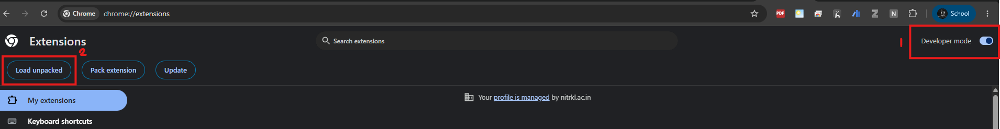
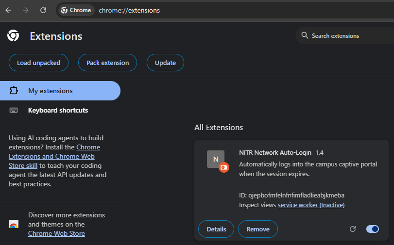
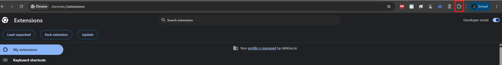
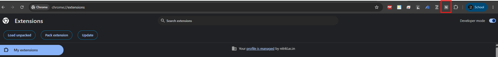
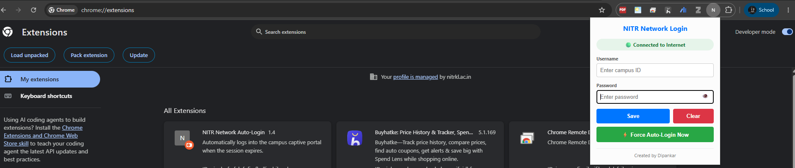
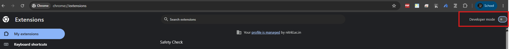

# NITR Network Auto-Login Chrome Extension

NITR Network Auto-Login is a Chrome extension designed to automate login to the NITR campus captive portal when a network session expires.

## Installation Guide

### Step 1: Download the project from GitHub

1. Open the GitHub repository where this README and the extension project are hosted.
2. Click the green **Code** button.
3. Select **Download ZIP**.
4. Wait for the ZIP file to download.

### Step 2: Extract the downloaded ZIP file

1. Open your computer's **Downloads** folder.
2. Find the downloaded ZIP file.
3. Right-click it and select **Extract All...** (Windows) or use your system's archive extraction option.
4. Open the extracted project **NITR-Network-Auto-Login** folder.
5. Confirm that the folder contains the extension files, including JavaScript (`.js`) files, HTML (`.html`) files, and `manifest.json`.

> **Important:** Do not try to load the ZIP file directly. Chrome needs the extracted folder containing `manifest.json`.

### Step 3: Open the Chrome Extensions page

1. Open Google Chrome.
2. Enter `chrome://extensions` in the address bar.
3. Press **Enter**.

### Step 4: Enable Developer mode

On the Chrome Extensions page, turn on the **Developer mode** toggle in the upper-right corner. This displays the tools used to load an extension from a local folder.

### Step 5: Load the extracted extension folder

1. Click **Load unpacked** near the upper-left corner.
2. In the folder-selection window, navigate to the project folder **NITR-Network-Auto-Login** you extracted in Step 2.
3. Select the folder that directly contains `manifest.json`.
4. Click **Select Folder** (the wording may vary by operating system).

Chrome will load the extension from the selected local folder.

### Step 6: Confirm that the extension is installed

Look under **All Extensions** for the extension card. Confirm that the extension appears and that its toggle is enabled.

### Step 7: Open the extension

Click the **Extensions** puzzle-piece icon in the Chrome toolbar to view available extensions.

Choose **NITR Network Auto-Login** from the list. If the extension icon is visible directly on the toolbar, you can click that icon instead.

### Step 8: Enter your campus credentials

When the extension popup opens:

1. Check the internet connection status.
2. Enter your campus ID in the **Username** field.
3. Enter your campus network password in the **Password** field.
4. Click **Save** to save the credentials according to the extension's implementation.

### Step 9: Run auto-login when needed

If you need to initiate login manually, click **Force Auto-Login Now** in the popup. Use **Clear** if you want to clear saved information.

The extension is intended to automate campus captive-portal login when the network session expires.

### Step 10: Turn off Developer mode (optional)

After installation, you may turn off **Developer mode** if you no longer need it. The extension should remain installed.

## Troubleshooting

- **The extension does not appear:** Confirm that you extracted the ZIP file and selected the extracted folder containing `manifest.json`.
- **Chrome reports an error:** Check that you selected the correct folder and that `manifest.json` is present.
- **Code changes do not appear:** Open `chrome://extensions` and click the extension's **Reload** icon.
- **Login does not work:** Check your campus ID, password, internet connection, and whether the campus captive portal is reachable.
- **Auto-Login does not work:** Make sure your system is on and chrome browser is always open

## Security Notes

- Use the extension only with networks and accounts you are authorized to access.
- Avoid saving credentials on shared or public computers.
- The security of saved credentials depends on the extension's implementation.
- Never commit passwords, campus IDs, session cookies, or other secrets to a public GitHub repository.

## Development

To test source-code changes, edit the local files, open `chrome://extensions`, and click **Reload** on the extension card.
